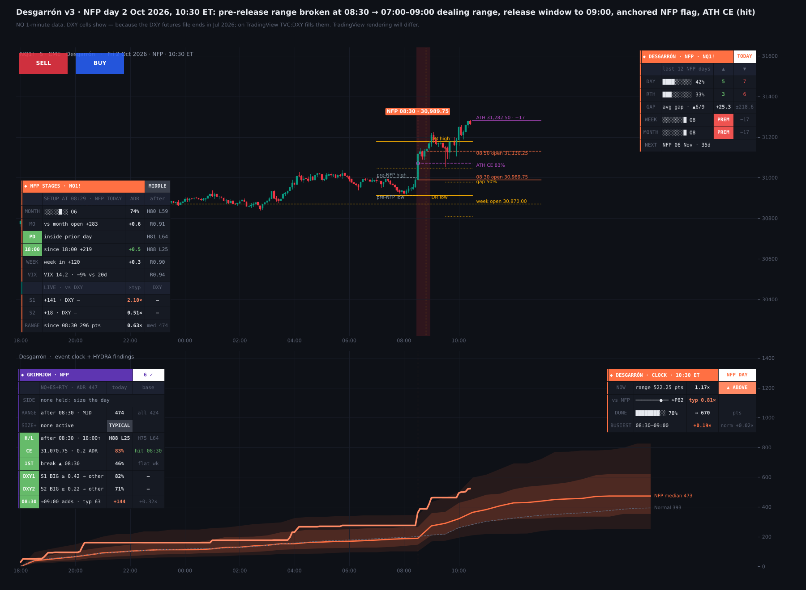
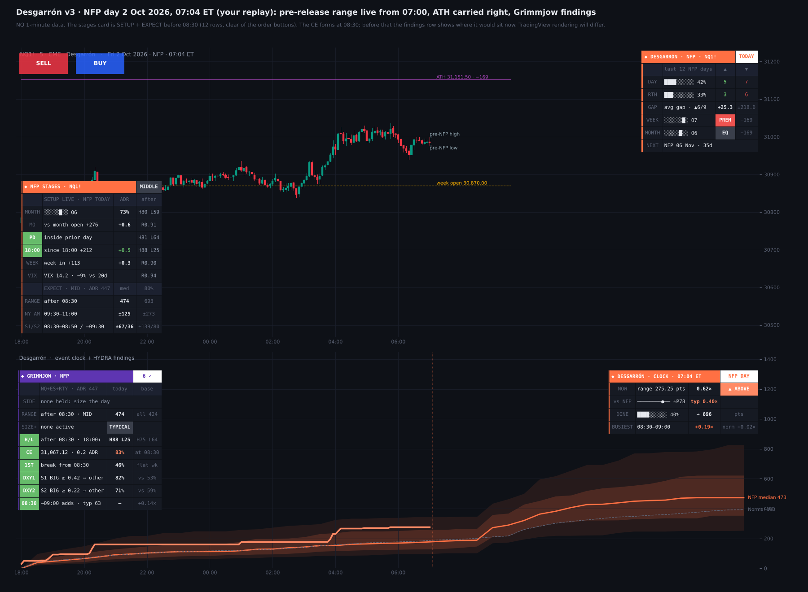
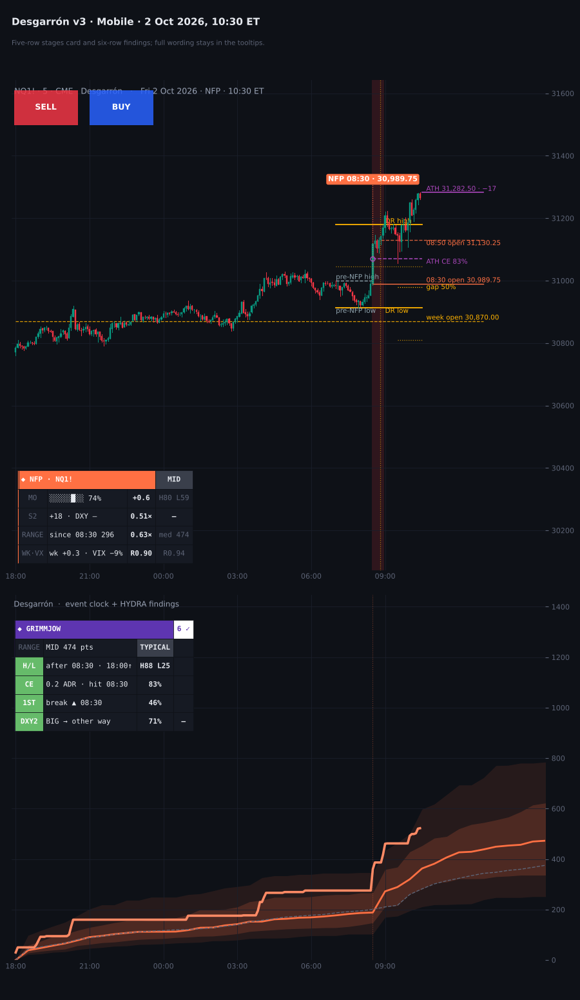

# Desgarrón

**NFP Day Model for NQ, ES & RTY**

TradingView indicator, Pine Script v6. Open source under the Mozilla Public License 2.0.

*Mock-up of how it looks on the chart.*

**Desgarrón** maps NFP days: the Employment Situation report, released at 08:30 ET. It covers five things:

- the structure the release trades into;
- how far NFP days with today's setup usually move, at today's ADR20;
- each release stage live against the dollar;
- Grimmjow, a table of what held for today's setup;
- today's range against the typical NFP day.

The figures are pooled across NQ, ES and RTY: 99 releases and 293 symbol-days. A ✓ row held in 2018–24, again in 2025–26, and on each of the three markets. *It is a map of how NFP days usually behave, not a signal generator.*

## What it draws on price

- **Pre-release range (07:00–08:29):** drawn live from 07:00. It stops at the bar where the release breaks one of its sides.
- **Dealing range (07:00–09:00):** created when the release breaks the pre-release range, or at 09:00 if it never does. It is drawn from 07:00, follows the high and low until 09:00, then stays fixed, with an optional 50% line and fill.
- **Release window:** 08:30 to 09:00 is shaded (the end is adjustable). A flag above the release push is tied by a stem to the 08:30 open.
- **Stage lines:** the 08:50 line, plus the 08:30 and 08:50 opens carried right of price.
- **Week open and RTH gap:** the week's open carried right, and from 09:30 the prior 16:14 close and the gap's 50%.
- **ATH:** the all-time high, drawn from the day it was set and carried right of price.
- **ATH CE:** at 08:30, the consequent encroachment (50%) between the ATH and the 08:29 close forms. It runs to 17:00 or into the next session to 11:00 (the Monday after a Friday release). Its label gives how often NFP days touched it from that distance.

How often NFP days touched the CE, by its distance from price at 08:29 (by 17:00 / by the next session's 11:00):

- within 0.5 ADR: **79%** / **83%**;
- 0.5–1 ADR: 23% / 31%;
- 1–2 ADR: 1% / 6%;
- beyond 2 ADR: 0% / 0%.

## Stages card

Stage 1 is 08:30 → 08:50 (the release push). Stage 2 is 08:50 → 09:30 (into the RTH open). The header pill shows where price sits in the month's range: *discount* (bottom quarter), *middle* or *premium* (top quarter). It shows this first because it is the setup that sized NFP days most.

**SETUP** runs live, then is fixed at 08:29 on NFP day. Each row shows the odds for its group:

- the month's octant;
- the distance from the month's open;
- the prior day's high and low;
- the move since 18:00;
- the week into the release;
- VIX against its 20-day average.

**EXPECT** (before 08:30) gives the median and 80th percentile at today's ADR20 for:

- the range after 08:30;
- NY AM;
- stage 1 and stage 2.

**LIVE** (after 08:30) shows:

- each stage in points, against its expected size and against DXY's move in the same window;
- the range since 08:30 against the expected median.

## Grimmjow (indicator pane)

Grimmjow lists what held on NFP days for today's setup, in points at today's ADR20.

- **Range after 08:30** for today's month position: **1.21** ADR from a discount vs **0.88** from a premium ✓. A second row lists the other size groups active today and whether they point bigger or smaller:
  - VIX more than 10% over its average: 1.35 ✓; more than 10% under: 0.69 ✓;
  - week up more than 0.5 ADR into the release: 0.82 ✓; week down: 1.34 ✓;
  - more than 1 ADR over the month's open: 0.90 ✓; under: 1.37 ✓.
- **New high / low after 08:30** for the most specific group active today:
  - from a monthly discount, a new low came on **91%** of days ✓;
  - from below the prior day's low: new high 36% ✓, new low 92% ✓;
  - after a drop of more than 0.4 ADR since 18:00: new high 19% ✓, new low 85% ✓.
- **ATH CE:** its distance, its odds and when it was hit. Within 0.5 ADR is held ✓.
- **First side of the pre-release range taken after 08:30:** it went on to be the bigger side of the day 59% of the time. With VIX more than 10% under its average: **79%** ✓. After an up week: 74% ✓. After a flat week: 46% ✓. The row also shows which side broke and when.
- **DXY:** once DXY's move is big, the index went the other way:
  - stage 1 (DXY moved ≥ 0.42 of its ADR20): **82%** vs 53% ✓;
  - stage 2 (≥ 0.22): **71%** vs 59% ✓.
- **08:30–09:00:** the day's range grows **+0.14** ADR at the median, against nothing on ordinary days ✓.
- **Side:** a HYDRA search over everything knowable at 08:29 found no feature that called the direction out of sample. That is why both the card and Grimmjow size the day rather than pick a side.

## Event clock and tally

- **Event clock (pane):** today's running range from 18:00 (or its net move), against NFP days or normal days at the same time of day. It shows the median path with 25–75% and 10–90% bands, in half-hour steps at today's ADR20. A NOW status reads *Above*, *Inside* or *Below* the middle half.
- **Tally card:**
  - the last N NFP days' up and down closes and their average RTH gap;
  - where price sits in this week's and this month's range, by octant;
  - the next release.

  *The octant is a locator, not a tested signal.*

## Settings

**View** sits at the top, the same as in my other indicators:

- **Pane:** clock + Grimmjow, the clock, Grimmjow, or cards only;
- **Clock measure:** range or net move;
- **Theme:** Auto follows the chart;
- **Layout:** Desktop or Mobile;
- **Card text:** tiny, small or normal.

**Model structure** has on/off, colour, style and width for each range, plus the 50% line and fill, how far the ranges run, the release window's end, label size, the ATH style and the CE's end.

**Mobile** folds the cards for a phone: a five-row stages card and a six-row Grimmjow. The full wording stays in the tooltips.

## How to use

- Built for **NQ / MNQ**, **ES / MES** and **RTY / M2K**, continuous or front month. On other symbols the clock and tally show NQ's figures.
- 1 to 15-minute charts suit the structure. The stages need 30 minutes or less, and the clock 60 minutes or less.
- Make the indicator pane tall enough for Grimmjow.
- For a phone, use a separate chart layout with *Layout = Mobile*, since chart layouts sync across devices.

## Data and method

- NQ, ES and RTY front-month 1-minute data, Jan 2018 – Oct 2026: 99 NFP releases, 293 symbol-days.
- A row gets a ✓ only if all of these held:
  - p < 0.05 with errors clustered by release date;
  - the same side in 2018–24 and in 2025–26;
  - the same side on each of NQ, ES and RTY.
- Several thousand group tests were run across the calendar models, so treat the ✓ rows as the steadiest descriptions, not proven edges. The rows with the most days behind them (range by month position, VIX and the week into the release, the big-DXY rows) are the most dependable.
- DXY rows: DXY futures, Feb 2023 – Jul 2026 (60 big-move stage-1 readings on 20 releases). On the chart they read TVC:DXY, which can be changed in the inputs.
- **ADR20** = mean (high − low) of the last 20 complete trading days.
- Release dates come from the BLS schedule and are loaded to Dec 2027. Add new years in S_NFP and raise LAST_DATE.
- No higher-timeframe value leaks future data.

## Limitations

*These are historical frequencies on 99 releases: useful context, not guarantees.* Same-window DXY rows describe how a stage finishes and cannot be known in advance. In Bar Replay, TradingView may not feed TVC:DXY minute by minute, so the DXY pills can read near zero there. The 2025 lapse moved two releases (20 Nov and 16 Dec 2025); both are in the dates. Nothing here is financial advice.

## Credits

ICT concepts (*Michael J. Huddleston*): the dealing range, consequent encroachment, premium and discount, the RTH gap and its 50%. Event clock after Kyōka Suigetsu. Part of the Hueco Mundo set; Grimmjow's claws are Model 6's disruption idea. Written from scratch; open source under MPL 2.0.

## Add it to TradingView

1. In TradingView, open the **Pine Editor** (bottom panel).
2. Copy the contents of `Desgarron.pine` into a new script.
3. **Save**, then **Add to chart**.

## More screenshots

## License

Mozilla Public License 2.0, see [LICENSE](LICENSE). © Unclehk2000.

*Historical frequencies, not guarantees. Nothing here is financial advice.*
